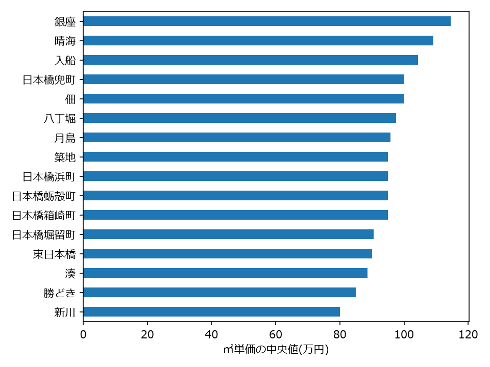
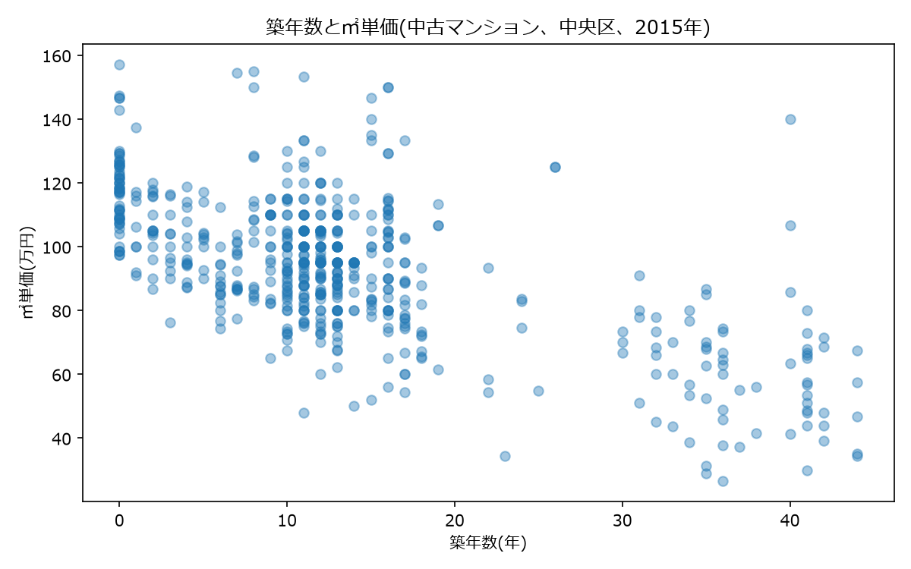

# 中央区の中古マンション価格の分析(2015年)

国土交通省のAPIで取引データを取得し、東京都中央区の中古マンションについて、地区や築年数によって㎡単価がどう違うかを調べました。取得、整形、SQL集計、可視化までを、Pythonで一通り行っています。

## 目的

マンションの価格は、部屋の広さで大きく変わります。そこで、取引価格を面積で割った「㎡単価」にそろえ、地区と築年数による違いをデータで確かめることを目的にしました。

## 使ったデータ

- 国土交通省「不動産情報ライブラリ」API(不動産取引価格情報)
- 対象: 東京都中央区、2015年(第1〜第4四半期)の取引719件のうち、中古マンション等の606件
- ㎡単価 = 取引価格 ÷ 面積、築年数 = 取引年 − 建築年

## 分かったこと

- **築年数が増えるほど、㎡単価の中央値は下がる。** 築0〜10年は約104万円/㎡、築30年以上は約60万円/㎡で、約42%の差があった。築20〜30年は13件と少なく、参考値にとどまる。
- **地区によって、㎡単価の中央値に差がある。** 件数が10件以上の16地区では、銀座が約114万円/㎡で最も高く、新川が約80万円/㎡で最も低かった。
- **晴海が高いのは、新しい物件が多いことが一因とみられる。** 晴海は築年数の中央値が0年で、全体では㎡単価が2位だが、築10〜20年に絞ると約82万円/㎡まで下がった(件数は6件で不安定)。
- **築年数をそろえても、勝どきは安い側にとどまった。** 築10〜20年に絞った平均で、件数10件以上の地区では最も低かった。
- **四半期ごとの中央値は、約90万円/㎡(第1)から約98万円/㎡(第4)へ上がった。** 1年分のデータなので、「上昇傾向に見える」までにとどめている。

## グラフ

地区別の㎡単価(件数10件以上の16地区、中央値)



築年数と㎡単価(中古マンション)



## 使った技術

Python 3.12 / requests / BeautifulSoup / pandas / SQLite / SQL / matplotlib

## ファイルの構成

| ファイル | 内容 |
|---|---|
| `01_scrape_practice.py` | 練習: スクレイピング練習用サイトから、全10ページを巡回してCSVに保存 |
| `02_quotes_chart.py` | 練習: 取得したデータを集計して、グラフにする |
| `03_fetch_trades.py` | APIから取引データを取得 |
| `04_clean_trades.py` | 型の変換、㎡単価・築年数の計算、中古マンションへの絞り込み |
| `05_sqlite_district.py` | SQLiteに保存して、SQLで地区別に集計 |
| `06_sql_age_filter.py` | 築年数を絞って、地区別に集計 |
| `07_age_bins.py` | 築年数の区間ごとに、件数と中央値を集計 |
| `08_chart_district.py` | 地区別の㎡単価を、横棒グラフにする |
| `09_chart_age.py` | 築年数と㎡単価の散布図を作る |

## 実行方法

1. 仮想環境を作り、ライブラリを入れる。
   ```
   python -m venv .venv
   .venv\Scripts\activate
   pip install -r requirements.txt
   ```
2. [不動産情報ライブラリ](https://www.reinfolib.mlit.go.jp/)でAPIキーを申請し、環境変数 `REINFOLIB_API_KEY` に設定する(コードにはキーを書かない)。
   ```
   setx REINFOLIB_API_KEY "（取得したキー）"
   ```
   設定後は、ターミナルを開き直す。
3. 番号の順に実行する(`03` から `09`)。
   ```
   python 03_fetch_trades.py
   python 04_clean_trades.py
   python 05_sqlite_district.py
   ```
   `03` で `raw_trades.csv`、`04` で `clean_mansion.csv` などのCSV、`05` で `trades.db` が作られる。

`01`、`02` は、スクレイピングの練習用で、`03` 以降とは独立している。

## 注意

- **APIキーは公開していない。** 環境変数から読み込む。
- **取引データのCSVとデータベースは、リポジトリに含めていない。** 利用条件の確認が済むまで公開せず、上の手順で再取得できる。
- **データは2015年の1年分で、現在の相場ではない。** 件数が少ない地区は、結果が不安定なので、件数10件以上の地区で比べている。
- 面積は整数で入っているため、㎡単価は目安の値。
- 出典: 国土交通省 不動産情報ライブラリ。利用規約に従う。
- 学習として、コードは自分で書き、解説とレビューをAI(Claude)から受けながら進めた。
